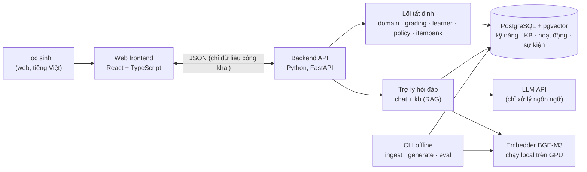
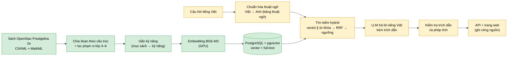

## 1. Báo cáo tiến độ ( 5/10 - 19/10)

- **Phần RAG**, . Pipeline đã đi được nửa chặng:
  - nạp sách nguồn;
  - chia đoạn (chunk) theo cấu trúc sách;
  - gắn kỹ năng cho từng đoạn;
  - tính embedding trên GPU;
  - lưu vào PostgreSQL + pgvector.

  Phần còn lại (tìm kiếm hybrid, sinh câu trả lời bằng LLM, giao diện) đang làm tiếp.
- **Kho tri thức hiện có:** 139 đoạn văn bản thuộc phạm vi lớp 4–6, lấy từ sách *OpenStax Prealgebra 2e*. Mỗi đoạn được gắn ít nhất một trong 12 kỹ năng phân số và có embedding 1024 chiều.

---

## 2. Kiến trúc tổng thể

### 2.1. Các thành phần

| Package (`backend/src/learning_agent/`) | Trách nhiệm | Trạng thái |
|---|---|---|
| `domain` | Đồ thị kỹ năng, bảng thuật ngữ Anh–Việt, misconception | ✅ kỹ năng và thuật ngữ |
| `kb` | Đọc sách nguồn, chia đoạn, gắn kỹ năng, embedding, lưu trữ, tìm kiếm | ✅ đến bước lưu trữ; tìm kiếm đang làm |
| `db` | Kết nối PostgreSQL, migration lược đồ | ✅ |
| `llm`, `chat` | Adapter gọi LLM (ghi và phát lại để test không tốn tiền), trả lời có trích dẫn | Tiếp theo |

### 2.2. Pipeline RAG (đang làm, milestone M6a)

Tài liệu mở có giấy phép rõ ràng chủ yếu bằng tiếng Anh. **Bảng thuật ngữ Anh–Việt một-đối-một** (33 thuật ngữ) là "từ điển chung" của toàn hệ thống. Bảng này dùng ở hai chiều:
- đổi thuật ngữ tiếng Việt trong câu hỏi sang tiếng Anh trước khi tìm;
- bảo đảm câu trả lời tiếng Việt dùng đúng một cách gọi cho mỗi khái niệm.

### 2.3. Công nghệ

| Lớp | Công nghệ |
|---|---|
| Ngôn ngữ, công cụ | Python 3.12, uv, Pydantic v2, pytest, ruff, pyright (strict) |
| Cơ sở dữ liệu | PostgreSQL 17 + pgvector 0.8.7, chạy bằng Docker Compose; psycopg 3 với SQL viết tay và migration đánh số |
| Embedding | BGE-M3 (đa ngôn ngữ, 1024 chiều, tối đa 8192 token), sentence-transformers, PyTorch + CUDA, GPU RTX 3050 4 GB |
| Dự kiến | FastAPI (API), LLM qua API tương thích OpenAI (Gemini free tier cho demo), React + TypeScript (giao diện đầy đủ) |

---

## 3. Công việc đã làm

### 3.1. RAG pipeline

| Bước | Nội dung | Kết quả |
|---|---|---|
|
| **R1** | Đồ thị kỹ năng và bảng thuật ngữ | 12 kỹ năng có quan hệ tiên quyết, kiểm tra chu trình (sắp xếp topo); 33 thuật ngữ Anh–Việt; test bảo đảm mọi thuật ngữ tiếng Anh đều xuất hiện trong sách |
| **R2** | Đọc sách (CNXML + MathML), chia đoạn theo cấu trúc | 249 đoạn thuộc 5 loại (lý thuyết, ví dụ mẫu, quy trình, tóm tắt, định nghĩa). Công thức MathML được chuyển thành dạng một dòng (`27/32 − 11/32`, `2 3/4`); đã chuyển 2718/2718 công thức không lỗi. Đoạn có số âm hoặc ví dụ đại số được đánh dấu ngoài phạm vi, kèm lý do |
| **R3** | PostgreSQL + pgvector bằng Docker; migration; gắn kỹ năng | 139 đoạn trong phạm vi được lưu, mỗi đoạn có ít nhất một kỹ năng (150 liên kết đoạn–kỹ năng); full-text search tiếng Anh |
| **R4** | Embedding trên GPU; lệnh `ingest` duy nhất | 139/139 đoạn có embedding; không đoạn nào bị cắt; mỗi lần chạy được ghi lại (commit, cấu hình, model) để tái lập |

### 3.2. Kết quả đo hiện tại

| Chỉ số | Giá trị |
|---|---|
| Đoạn trong phạm vi / tổng số | 139 / 249 |
| Phân bố theo loại | lý thuyết 61 · ví dụ mẫu 55 · quy trình 11 · định nghĩa 8 · tóm tắt 4 |
| Thời gian chạy `ingest` (toàn bộ) | khoảng 15 giây; riêng embedding 2,1 giây trên GPU |
| Bộ nhớ GPU tối đa | khoảng 1,3 GB / 4 GB |
| Đoạn dài nhất | 624 token (giới hạn của model là 8192, nên không đoạn nào bị cắt) |
| Chỉ mục HNSW | 139/139 đoạn tìm lại được chính nó ở hạng 1 |
| Test tự động | 181 đạt, 0 bỏ qua |

**Thử nghiệm nhanh** (chưa phải số liệu đánh giá; đánh giá chính thức ở bước R6):

| Câu hỏi | Kết quả |
|---|---|
| "What is the reciprocal of a fraction?" | ✅ Hạng 1 là đúng định nghĩa *reciprocal* |
| "mẫu số chung nhỏ nhất là gì" | 🟡 Cả 5 kết quả đầu đều thuộc mục "Find the Least Common Denominator" |
| "số nghịch đảo của phân số là gì" | ❌ Model embedding không hiểu thuật ngữ "số nghịch đảo" |

Kết quả thứ ba là bằng chứng cho thiết kế bảng thuật ngữ. Câu hỏi tiếng Việt dùng từ thông dụng thì model tìm đúng, nhưng thuật ngữ chuyên ngành cần được đổi sang tiếng Anh trước khi tìm.

---

## 4. Kế hoạch tiếp theo

**Hoàn thành demo RAG (M6a):**

| Bước | Nội dung |
|---|---|
| R5 | Tìm kiếm hybrid: chuẩn hóa thuật ngữ Việt → Anh, tìm theo vector và theo từ khóa song song, gộp bằng RRF, ngưỡng từ chối |
| R6 | Bộ câu hỏi chuẩn khoảng 30 câu (tiếng Việt và tiếng Anh); đo Recall@k và MRR; so sánh tìm kiếm chỉ dùng vector với tìm kiếm hybrid |
| R7 | Adapter gọi LLM  |
| R8 | Sinh câu trả lời tiếng Việt có trích dẫn; kiểm tra trích dẫn và phép tính; từ chối khi ngoài phạm vi |
| R9 | API và trang web demo  |
| R10 | Chạy thử toàn bộ demo, hoàn thiện tài liệu |
